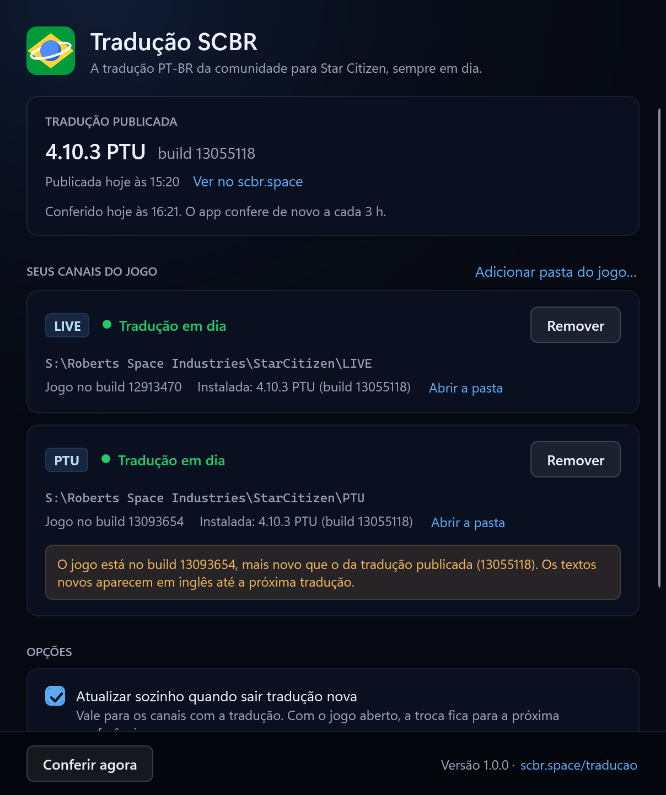

# Tradução SCBR

App de bandeja do Windows que instala, mantém em dia e remove a tradução PT-BR da comunidade para Star Citizen.
Ele sai pela Microsoft Store e é feito pela comunidade Star Citizen Brasil ([scbr.space](https://scbr.space)), sem
vínculo com a Cloud Imperium Games.



## O que o app faz

- **Acha os canais do jogo** (LIVE, PTU, EPTU, HOTFIX, TECH-PREVIEW): nas pastas que a pessoa escolheu, no log do
  RSI Launcher (`%APPDATA%\rsilauncher\logs`, que diz de onde cada canal foi aberto) e nas pastas comuns de cada
  disco (as mesmas que os `.cmd` da equipe de tradução procuram, como
  `C:\Program Files\Roberts Space Industries\StarCitizen`). Um canal é uma pasta com o `Data.p4k` ou o
  `build_manifest.id`. Se o jogo estiver em outro lugar, "Adicionar pasta do jogo…" aceita a pasta do canal, a
  `data` dentro dela, a `StarCitizen` ou a `Roberts Space Industries`.
- **Lê o build de cada canal** no `build_manifest.id`, no campo `RequestedP4ChangeNum`. O `Branch` não serve (no PTU
  4.10.3 ele dizia `sc-alpha-4.10.0`).
- **Instala a tradução publicada** pela ferramenta do site em
  `<canal>\data\Localization\portuguese_(brazil)\global.ini` e põe `g_language = portuguese_(brazil)` no
  `<canal>\user.cfg`. As outras linhas do `user.cfg` ficam (inclusive a `g_languageAudio`), e o anterior vira
  `user.cfg.bak`. O arquivo só é instalado se o tamanho e o sha256 baterem com os publicados.
- **Mantém em dia:** confere a tradução publicada ao abrir, a cada 3 horas, ao voltar da suspensão e quando a internet
  volta. Com "Atualizar sozinho" (o padrão), troca o arquivo dos canais que têm a tradução e guarda o anterior como
  `global.ini.bak`. Se o launcher apagar a pasta numa atualização do jogo, o app instala de novo.
- **Avisa** por notificação do Windows quando atualiza a tradução, quando sai uma nova (com "Atualizar sozinho"
  desligado) e quando o jogo de um canal com a tradução fica num build mais novo que o da tradução publicada. O ícone
  da bandeja ganha um ponto de aviso nesses casos. O app percebe na hora quando o launcher atualiza o jogo.
- **Remove por canal:** apaga a pasta `portuguese_(brazil)` e tira a linha do `user.cfg` (se o arquivo ficar vazio,
  ele sai). O jogo volta ao inglês naquele canal.
- **Inicia com o Windows,** na bandeja, se a pessoa quiser (ligado na primeira vez; desliga na janela ou em
  Configurações > Aplicativos > Inicialização).

Quem já usa a tradução pelos `.cmd` da equipe não precisa fazer nada: o app vê a tradução instalada e escolhida no
`user.cfg`, passa a cuidar dela e troca pela publicada no site.

## Desinstalar

**Remova a tradução de cada canal antes de desinstalar o app.** Um app da Microsoft Store (MSIX) não roda nada na
desinstalação, então ele não consegue limpar a pasta do jogo depois. Se o app já saiu, dá para limpar à mão: apague
`<canal>\data\Localization\portuguese_(brazil)` e a linha `g_language = portuguese_(brazil)` do `<canal>\user.cfg`.
Ou instale o app de novo e use "Remover".

As configurações e o arquivo baixado ficam na pasta do app no Windows e saem junto com ele.

## Privacidade

O app só se conecta ao scbr.space, para saber qual é a tradução publicada e baixar o arquivo
([a API](docs/api.md)). Ele não pede login, não manda dados pessoais e não tem telemetria. No PC, ele lê as pastas
do jogo (`build_manifest.id` e `user.cfg`) e o log do RSI Launcher, só para achar o jogo, e grava a tradução nos
canais que a pessoa escolher. Política de privacidade: <https://scbr.space/privacidade>.

## Por dentro

| Pasta | O que tem |
|---|---|
| `src/TraducaoScbr.Core` | O núcleo, sem tela: `Game/` (o `build_manifest.id`, o log do launcher e a busca dos canais), `Translation/` (a API, o `user.cfg` e a instalação), `State/` (as configurações e as regras de atualizar e avisar) e o `TranslationService`, que junta tudo. |
| `src/TraducaoScbr` | O app (WPF): a janela, a bandeja (o `NotifyIcon` do WinForms), as notificações e o início com o Windows. |
| `tests/TraducaoScbr.Core.Tests` | Os testes do núcleo (xUnit), com um jogo de mentira em pastas temporárias e um scbr.space de mentira. |
| `packaging` | O manifesto do MSIX, as imagens do pacote, o índice delas e o `build-msix.ps1`. |
| `tools` | O mock da API, o gerador dos ícones e o das capturas da loja (arquivos C# que rodam com `dotnet run`). |
| `docs` | [A API](docs/api.md), [o envio à loja](docs/loja.md) e [o texto para a política de privacidade do site](docs/privacidade.md). |

## Desenvolvimento

Precisa do Windows 10 ou 11 e do [SDK do .NET 10](https://dotnet.microsoft.com/download/dotnet/10.0).

```bash
dotnet build TraducaoScbr.slnx
```

```bash
dotnet test TraducaoScbr.slnx
```

**Nunca teste no jogo de verdade.** Crie um jogo de mentira, com uma pasta por canal com um `Data.p4k` vazio e um
`build_manifest.id` (copie o do seu jogo), e rode o app só com ela, contra o mock da API:

```bash
dotnet run tools/mock-api.cs -- C:\teste\mock
```

```bash
dotnet run --project src/TraducaoScbr -- --api http://localhost:5199 --dados C:\teste\dados --pastas "C:\teste\StarCitizen"
```

A pasta do mock tem o `global.ini` a publicar e um `publicacao.json`
(`{ "versao": "4.10.3", "canal": "PTU", "build": 13055118, "publicadaEm": "2026-11-04T15:20:00-03:00" }`). O mock
relê os dois a cada pedido: troque o arquivo e o build para simular uma tradução nova. Sem o `global.ini`, a API
responde 404 (nada publicado); `"falha": 503` simula um erro e `"corromper": true` serve um arquivo que não bate com
o sha256.

| Opção | Para quê |
|---|---|
| `--api <url>` | Outro endereço da API (também pela variável `TRADUCAO_SCBR_API`). |
| `--dados <pasta>` | Outra pasta de configurações, em vez de `%LOCALAPPDATA%\TraducaoSCBR`. |
| `--pastas "<p1>;<p2>"` | Só estas pastas, sem procurar o jogo no PC. |
| `--bandeja` | Abre sem a janela, como no login. |
| `--captura <arquivo.png>` | Grava a janela numa imagem (2x) e fecha. É de onde saem as capturas do README e da loja. |

O registro do app fica em `registro.txt`, na pasta de dados.

Os ícones saem do símbolo da Star Citizen Brasil, desenhado em código: `dotnet run tools/gerar-icones.cs`. As
capturas da loja: `dotnet run tools/compor-prints.cs -- <captura.png> <saida.png> "<título>" "<texto>"`.

## Gerar o MSIX

```bash
powershell -File packaging/build-msix.ps1
```

Sai `artifacts/TraducaoSCBR_<versão>_x64.msix`, sem assinatura (a loja assina), com ~73 MB: o app leva o próprio
.NET, e as atualizações pela loja baixam só o que mudou. O script usa o `makeappx` e o `makepri` do Windows SDK, se
ele estiver instalado, ou os do pacote NuGet `Microsoft.Windows.SDK.BuildTools`, baixado no primeiro uso. Sem
parâmetros, o pacote tem uma identidade de teste; para a loja, veja [docs/loja.md](docs/loja.md). A versão vem de
`Directory.Build.props`.

Para testar o pacote no PC (com o Modo de Desenvolvedor do Windows ligado), monte a pasta e registre:

```bash
powershell -File packaging/build-msix.ps1 -SoLayout
```

```powershell
Add-AppxPackage -Register artifacts\layout\AppxManifest.xml
```

Ele aparece no menu Iniciar como "Tradução SCBR". Para tirar:
`Get-AppxPackage SCBR.TraducaoSCBR.Teste | Remove-AppxPackage`.

## CI

O GitHub Actions (`windows-latest`) compila, roda os testes e gera o MSIX a cada PR e a cada push na `main`. O
pacote fica como artefato do workflow (`TraducaoSCBR-msix`). Com as variáveis do repositório `LOJA_IDENTITY_NAME`,
`LOJA_PUBLISHER` e `LOJA_PUBLISHER_DISPLAY_NAME` (os valores da identidade na loja, que não são segredo), o pacote do
CI já sai pronto para o envio.
